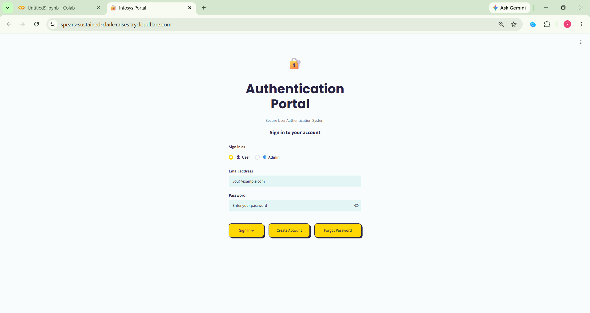
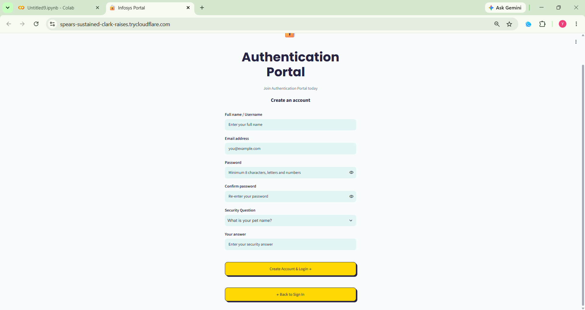
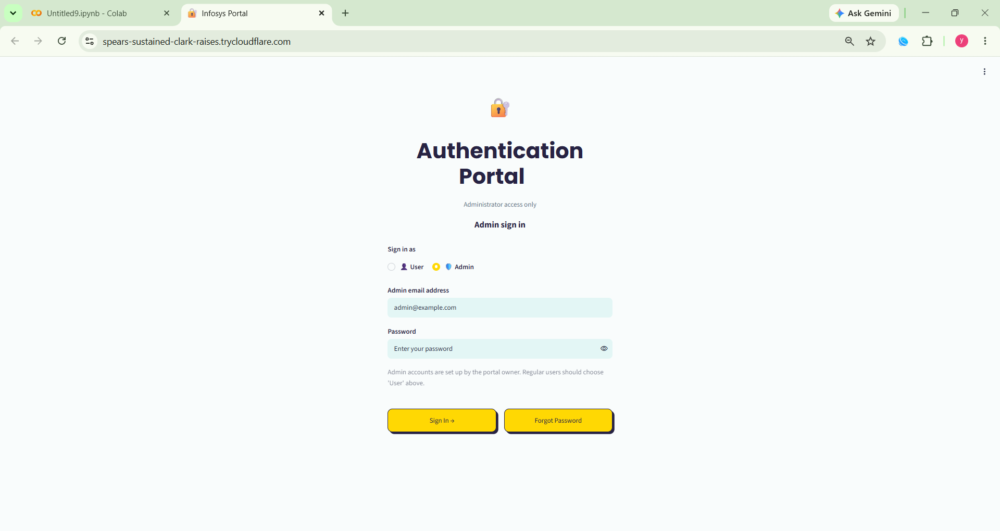
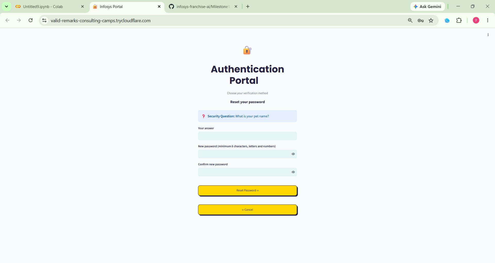
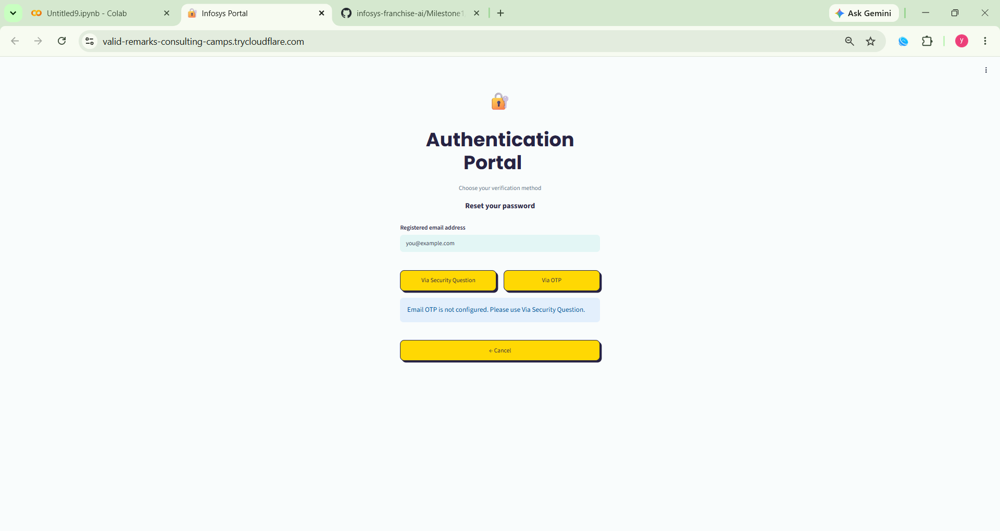
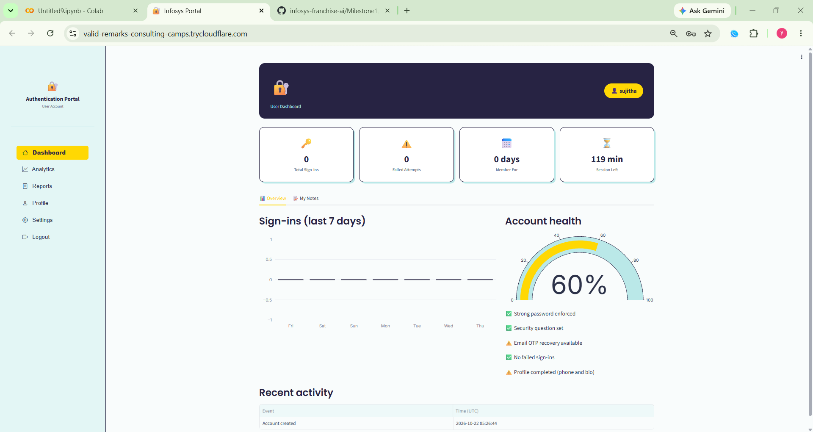
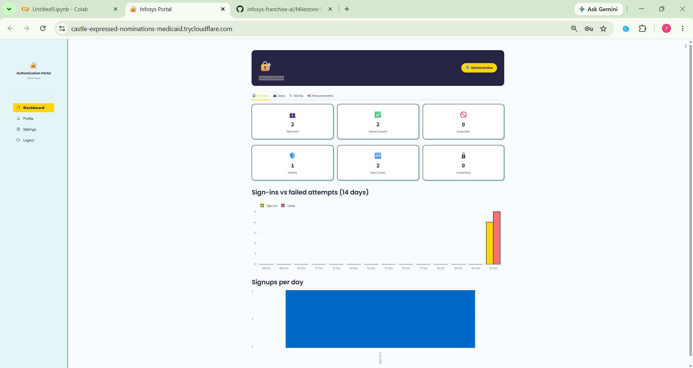

# Infosys Springboard Internship 7.0 — Milestone 1

## User Authentication Portal

### Project Overview
The User Authentication Portal is a web application developed as part of Infosys Springboard Internship 7.0. It provides user registration, login, password recovery, OTP-based email verification, and dashboard access.

The application is built using Python and Streamlit, with SQLite for database management. It uses bcrypt for password hashing and JSON Web Tokens (JWT) for authentication.

### Features
- **User Signup:** Register a new user account.
- **User Login:** Authenticate registered users.
- **Forgot Password:** Support password recovery through email and OTP verification.
- **Email OTP Verification:** Send and verify one-time passwords through email.
- **User Dashboard:** Provide access to the user dashboard after successful authentication.
- **Admin Dashboard:** Provide a separate dashboard for administrative functions.
- **Password Security:** Hash passwords using bcrypt.
- **JWT Authentication:** Use JWT for authentication and session-related operations.
- **Database Management:** Store user information in an SQLite database.

### Technologies Used
- Python
- Streamlit
- SQLite
- bcrypt
- PyJWT
- SMTP and Python EmailMessage
- Google Colab
- ngrok for temporary public access during testing

### Project Structure

```text
Milestone1/
├── README.md
├── Milestone1_Authentication_Portal.ipynb
└── screenshots/
    ├── login.png
    ├── signup.png
    ├── forgot_password_email.png
    ├── forgot_password_otp.png
    ├── otp_email.png
    ├── user_dashboard.png
    └── admin_dashboard.png
```

### Setup and Execution

1. Open the project notebook in Google Colab.
2. Install the required Python packages.
3. Configure the required credentials using Google Colab Secrets.
4. Run the notebook cells in the correct order.
5. Start the Streamlit application.
6. Create a temporary public URL using ngrok.
7. Open the generated URL and test the authentication features.

### Configuration and Secrets

The application requires sensitive configuration values to be stored securely in Google Colab Secrets or environment variables.

Depending on the application's configuration, these include:

- `JWT_SECRET` — secret used for JWT signing.
- `NGROK_AUTHTOKEN` — authentication token for ngrok.
- Gmail credentials required for sending OTP emails.

**Security:** Never commit actual passwords, Gmail app passwords, JWT secrets, ngrok tokens, OTPs, or other private credentials to the repository.

## Screenshots

### 1. User Login Page


### 2. User Sign Up Page


### 3. Admin Sign In Page


### 4. Forgot Password — Email Route


### 5. Forgot Password — OTP Route


### 6. User Dashboard


### 7. Admin Dashboard



### Security Considerations
- Passwords should be stored as bcrypt hashes rather than plain text.
- JWT secrets and email credentials must be kept private.
- OTPs should have an appropriate expiration period and verification limits.
- Administrative access should be restricted to authorized users.
- A public ngrok URL should be used for testing only unless the application has been properly secured for deployment.

### Project Objective
The objective of this milestone is to develop and demonstrate a user authentication system with registration, login, password recovery, email OTP verification, and dashboard functionality.

### Internship
**Program:** Infosys Springboard Internship 7.0  
**Batch:** 4  
**Milestone:** 1 — User Authentication Portal
